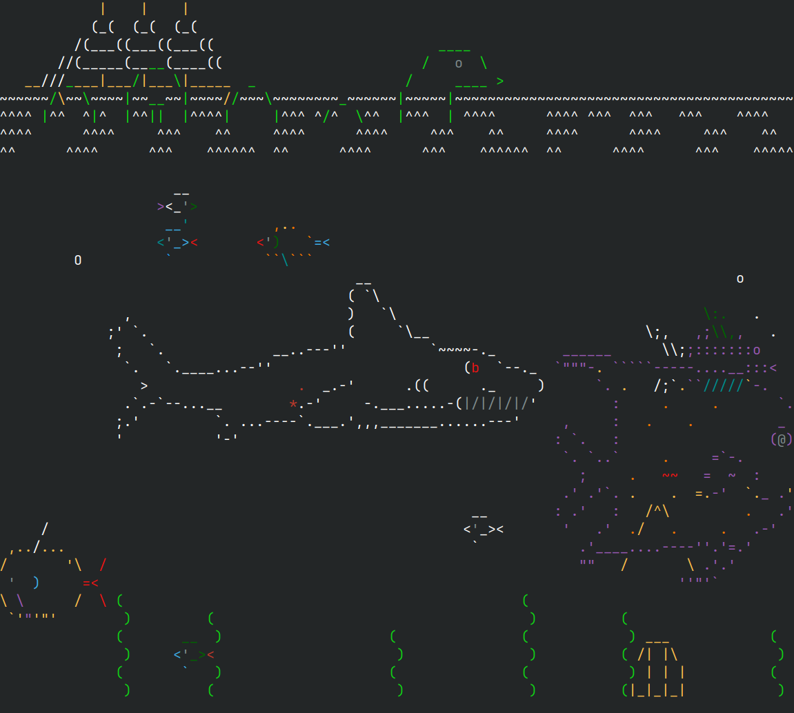

# Aquarium

Port of Asciiquarium from Perl to Go.

### Installation

Installation with `go`:

    go install github.com/xyproto/aquarium@latest

The executable will then end up in `~/go/bin` (or where `$GOPATH` / `$GOBIN` has been set to).

### Screenshot

### General info

* License: GPL2
* Version: 1.0.2
